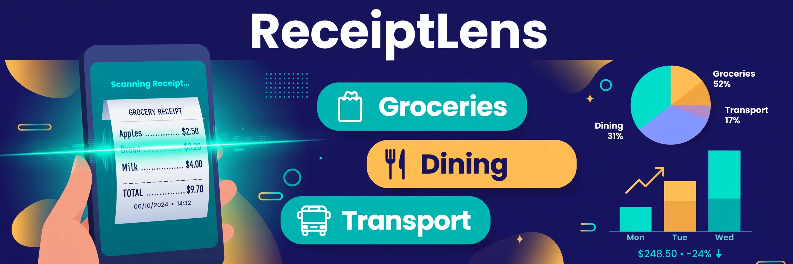
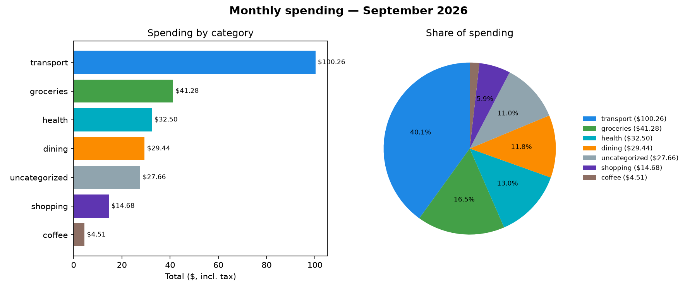

# ReceiptLens

**Snap a photo of any receipt — get an auto-categorized spending dashboard.**




ReceiptLens turns a pile of paper receipts into answers: *where did my money actually go this month?* Point it at receipt photos (or scans, or plain text), and it OCRs them, parses every line item, auto-categorizes each purchase with transparent keyword rules, and produces a monthly spending report with charts — all offline, all in a single SQLite file you own.

## Screenshots

| Monthly report chart (generated by `receiptlens report`) |
| --- |
|  |

The chart above isn't a mockup — it's the actual PNG produced by running the demo below.

## Features

- **Pluggable OCR** — uses `tesseract` when it's installed; otherwise falls back to bundled demo text, so the demo runs with zero setup and no network.
- **Line-item parser** — deterministic regex/heuristic engine extracts merchant, date, line items, subtotal, tax and total, with a balance check (`subtotal + tax == total`) on every receipt.
- **Rule-based categorizer** — transparent keyword rules in `data/categories.yaml` (groceries, dining, coffee, transport, shopping, health, entertainment). Longer, more specific keywords outscore generic ones (`garlic bread` beats `bread`), and anything unmatched lands in an **uncategorized review queue** you can fix with one command.
- **SQLite store** — receipts, items and categories in one file; content-hash deduplication means re-ingesting the same folder is always safe.
- **Monthly reports** — terminal table, Markdown report, and a matplotlib bar + pie chart. Category totals are tax-inclusive (tax is distributed proportionally), so they reconcile with what you actually paid.
- **Small CLI** — `ingest`, `report`, `categories`, `recategorize`. No API keys, no cloud, no accounts.

## Tech stack

| Layer | Choice |
| --- | --- |
| Language | Python 3.10+ |
| OCR | `tesseract` via subprocess (optional; graceful fallback) |
| Parsing | `re` + heuristics, zero ML |
| Categorization | keyword rules from a YAML-subset file (parsed with stdlib) |
| Storage | `sqlite3` (stdlib) |
| Charts | `matplotlib` (the only runtime dependency) |
| CLI | `argparse` (stdlib) |
| Tests | `pytest`, 60 tests |

## Quickstart

Copy-paste — this works end to end on the bundled demo data:

```bash
git clone https://github.com/PARTHPATEL5577/receiptlens.git
cd receiptlens
python3 -m venv .venv && source .venv/bin/activate   # Windows: .venv\Scripts\activate
pip install -e ".[dev]"

# 1. Ingest the 8 bundled demo receipts (2 are photos, OCR'd via demo fallback)
python -m receiptlens ingest data/receipts

# 2. September 2026 report: terminal table + Markdown + chart PNG
python -m receiptlens report --month 2026-09

# 3. See what the categorizer couldn't place, then fix one item
python -m receiptlens categories --review
python -m receiptlens recategorize 25 shopping   # use the ID from your review queue

# 4. Run the test suite
python -m pytest
```

What you'll see:

```
$ python -m receiptlens ingest data/receipts
OCR engine: not found — images will use their bundled demo text
  ++ 2026-08-29-cineplex.txt: Cineplex Odeon · 2026-08-29 · 4 items · $57.01 [text]
  ++ 2026-09-04-fortinos.png: Fortinos · 2026-09-04 · 7 items · $41.28 [demo-fallback]
  -- 2026-09-04-fortinos.txt: duplicate of an ingested receipt, skipped
  ...
Ingested 8 receipt(s), skipped 2 duplicate(s), failed 0 -> receipts.db

$ python -m receiptlens report --month 2026-09
Spending report — September 2026
================================
Receipts: 7   Items: 25   Total: $250.33

Category          Items       Total   Share
---------------------------------------------
transport             4$     100.26   40.1%
groceries             7$      41.28   16.5%
health                4$      32.50   13.0%
dining                5$      29.44   11.8%
uncategorized         2$      27.66   11.1%  <-- review
shopping              1$      14.68    5.9%
coffee                2$       4.51    1.8%
---------------------------------------------
Tax (HST/GST)          $      28.80

Top merchants:
  Shell                        $76.59
  Canadian Tire                $42.34
  Fortinos                     $41.28
  ...

Saved report: reports/2026-09-report.md
Saved chart:  reports/2026-09-spending.png
```

> **Have tesseract?** Install it (`apt install tesseract-ocr` / `brew install tesseract`) and ReceiptLens will OCR real receipt photos automatically — no code changes, the engine is detected at runtime.

## How it works

```
receipt photo / scan / .txt
        │  ocr.py — tesseract if present, else paired .txt fallback
        ▼
   raw text
        │  parser.py — merchant, date, items, subtotal, tax, total (+ balance check)
        ▼
  ParsedReceipt
        │  categorizer.py — keyword rules from data/categories.yaml
        │                   → "uncategorized" review queue on no match
        ▼
   SQLite (receipts.db) — content-hash dedup on ingest
        │  report.py — tax-inclusive monthly aggregation
        ▼
  terminal table · Markdown report · bar+pie chart PNG
```

The categorizer is deliberately boring: no black box. Open `data/categories.yaml`, add a keyword, re-run — your rules are the model, and they fit in one screen.

## Project structure

```
receiptlens/
├── receiptlens/                 # the package
│   ├── __init__.py
│   ├── __main__.py              # python -m receiptlens
│   ├── cli.py                   # ingest / report / categories / recategorize
│   ├── ocr.py                   # pluggable OCR (tesseract → demo fallback)
│   ├── parser.py                # receipt line-item parser
│   ├── categorizer.py           # keyword rules engine + YAML-subset loader
│   ├── store.py                 # SQLite schema + queries
│   ├── report.py                # monthly aggregation, tables, charts
│   └── categories.yaml          # rules bundled with the package
├── data/
│   ├── categories.yaml          # editable category rules (single source of truth)
│   └── receipts/                # 8 demo receipts (.txt) + 2 mock receipt photos (.png)
├── docs/
│   ├── hero-banner.png
│   └── monthly-spending.png     # real chart produced by the demo run
├── scripts/
│   └── render_demo_receipts.py  # regenerates the mock receipt photos
├── tests/                       # 60 pytest tests (parser → CLI end-to-end)
├── pyproject.toml
├── LICENSE
└── README.md
```

## Roadmap

- [ ] Real OCR test path in CI (install tesseract, OCR the mock photos, assert text similarity)
- [ ] Merchant normalization — alias `TIM HORTONS #4521` to a brand page with per-brand totals
- [ ] CSV / YNAB export of categorized items
- [ ] Multi-currency receipts with FX conversion
- [ ] Perceptual-hash dedup for re-photographed receipts (beyond exact-text dedup)
- [ ] Tiny web dashboard (read-only) served straight from the SQLite file
- [ ] Opt-in local-model categorizer as a fallback behind the rules engine

## License

MIT — see [LICENSE](LICENSE). Copyright (c) 2026 Parth (PARTHPATEL5577).
